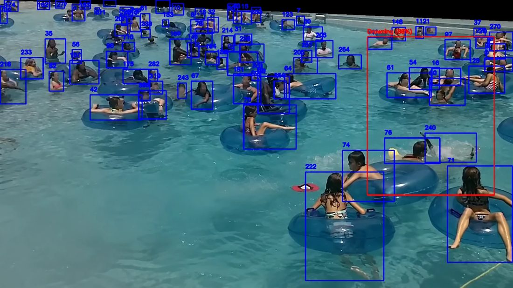
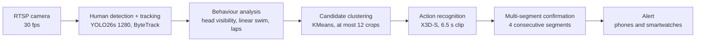
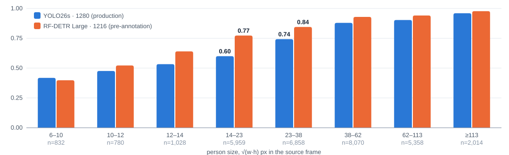
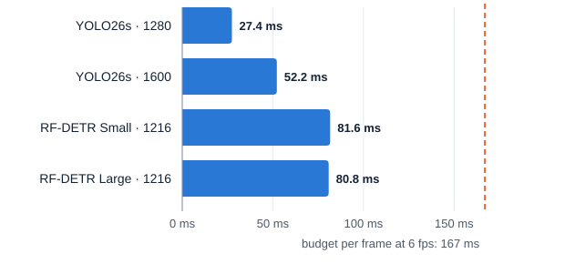
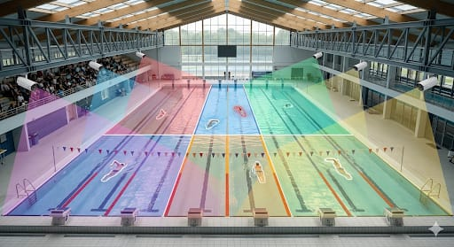

# DrownShieldAI | Real-time drowning detection on the edge

A camera system that watches a swimming pool and alerts the lifeguards when a person shows drowning behaviour. Everything runs in real time on an NVIDIA Jetson Orin Nano next to the pool; alerts with an image and the last 15 seconds of video go through Azure to the lifeguards' phones and smartwatches.

The system is in trial deployment. Product website: [drownshieldai.com](https://drownshieldai.com/)

> Public portfolio snapshot with a fresh history. It contains the perception pipeline, training and export code, the annotation review tool and the tests. Trained models, datasets, videos, the alerting and cloud integration, and device provisioning are not included. See [PORTFOLIO.md](PORTFOLIO.md).



## Engineering highlights

- A four-stage pipeline that fits a 167 ms per-frame budget on an 8 GB Jetson: detection and tracking, behaviour filtering, video action recognition, multi-segment confirmation.
- Detector choice made on measured accuracy and on-device latency: YOLO26s in production, RF-DETR Large for pre-annotation.
- A rule-based behaviour filter (head visibility, linear swimming, laps) that removes clearly safe swimmers before the video model runs, covered by 256 unit tests built from recorded tracks.
- Model-assisted labelling of very small people (SAM 3 and RF-DETR predictions, human review tool) and scene-level dataset splits that keep near-identical frames out of the test set.
- All models exported to TensorRT FP16 and packaged as Docker containers.

**Technology:** Python, PyTorch, PyTorchVideo, Ultralytics YOLO, RF-DETR, ByteTrack, ONNX, TensorRT, OpenCV, MLflow, Docker, NVIDIA Jetson, Azure, pytest.

## The problem

Drowning is usually silent and fast. There is no shouting or waving; the person is often vertical with the head at or below the surface. Lifeguards watch large areas with many swimmers, and a few seconds of inattention can be fatal.

The engineering constraints shaped every decision:

| Constraint | Value |
|---|---|
| Hardware | NVIDIA Jetson Orin Nano, 8 GB memory shared by CPU and GPU, one per installation |
| Throughput | 6 processed frames per second, a 167 ms budget per frame for all models |
| False alarms | Pools tolerate about 2–3 per camera per day; beyond that staff stop trusting alerts |
| Cameras | Above water: glare, reflections, crowds and very small people at distance |

## Pipeline



1. **Detect everyone.** YOLO26s finds and tracks every person. A per-track history of boxes and head-visibility predictions is kept for about 5.5 seconds.
2. **Discard the obviously safe.** Behaviour analysis removes people whose head is clearly above water, lap swimmers and swimmers turning at the wall.
3. **Classify the rest.** The remaining candidates are grouped into at most 12 crops, and X3D-S classifies each 6.5-second clip as drowning or normal.
4. **Confirm.** An alert fires only when the same location is flagged over consecutive segments.

## Results

### Human detection

YOLO26s, single class, 1280 × 1280 input, TensorRT FP16. The test set has 1,380 images with 31,001 labelled people, up to 325 in one image. Splits are made per scene, never per frame, so no scene appears in both training and test data.

| Input size | mAP50 | Recall, people ≥ 14 px | Jetson latency |
|---|---|---|---|
| 1280 | 0.81 | 0.80 | 27 ms |
| 1600 | 0.82 | 0.81 | 52 ms |
| 1920 | 0.83 | 0.80 | not measured |

1280 is the operating point: most of the small-object benefit at half the cost of 1600. A dedicated small-object head (P2) gave no recall gain at 1600 and above.

Recall depends strongly on person size. 28 % of all labelled people are smaller than 23 px in a 1920 px frame, which is a few pixels of head above the water:



### Choosing the detector

| | YOLO26s · 1280 | RF-DETR Large · 1216 |
|---|---|---|
| Test mAP50 | 0.81 | 0.84 |
| Recall, people ≥ 14 px | 0.80 | 0.88 |
| Precision, people ≥ 14 px | 0.80 | 0.76 |
| Jetson latency | 27 ms | 81 ms |



Measured on a Jetson Orin Nano Super (25 W), TensorRT 10.3 FP16, batch 1. RF-DETR is more accurate but three times slower, and alone it would take half the frame budget. YOLO26s runs in production. RF-DETR Large is used for pre-annotation, where recall matters and speed does not.

### Video action recognition

Binary classification of each crop clip. Drowning is recognised from motion over time (vertical posture, head at the surface, climbing-ladder arm movement, no forward progress), so a video model is needed, not a single-frame classifier.

| | X3D-S (production) | Swin-T |
|---|---|---|
| Frames × sampling rate | 13 × 15 | 16 × 10 |
| Clip duration at 30 fps | 6.5 s | 5.3 s |
| Input crop | 182 × 182 | 224 × 224 |
| Test accuracy | 97.27 % | 98.14 % |
| Jetson Orin Nano 8 GB | runs in real time | too much CPU, RAM and GPU |

Swin-T is 0.9 points more accurate but needs a more expensive Jetson, so X3D-S runs in production.

Training used 12,293 clips with a normal-to-drowning ratio of about 2 : 1, focal loss (α = 0.4, γ = 2), and video augmentation applied consistently across all frames of a clip. Each location and recording stays in one split.

### End-to-end operating point

A single clip classified as drowning does not raise an alert. The predictions of the last four segments are kept with their crop locations, and an alert requires agreement at the same location.

| Measure | Value |
|---|---|
| Drowning test videos still detected after confirmation | 91 % |
| False alarms | 2–3 per camera per day |

Confirmation removes isolated wrong clips (splashing, diving, play) at the cost of about 9 % of true detections. Its thresholds set the trade-off between missed incidents and alarm fatigue.

## Design decisions

**Filter before classifying.** A crowded pool zone can hold more than 20 people. Without filtering, one crop for the action model contains many people swimming normally and the drowning signal is diluted. After filtering, typically one to three candidates remain, the crops are tighter and the compute per frame is bounded.

**Asymmetric errors.** A false candidate costs compute; a false exclusion can cost a life. Every filter keeps a person as a candidate when the evidence is ambiguous, and a missing detection is never read as "submerged", because the detector also misses visible people.

**Two cameras per zone.** Water glare can make a whole region invisible to one camera. Each zone is covered from two opposite sides, which reduces blind spots but does not remove them.



**Label quality limits small-person recall.** Below about 12 px a person is a few pixels of head, hard for the detector and for the annotator alike. Areas where people cannot be identified are masked out of training instead of being labelled inconsistently.

**Scarce real data.** About 150 real drowning videos exist publicly, mostly low quality. Most of the drowning data was staged with volunteers in several countries, with lifeguards securing every session. Staged data teaches the motion pattern; real footage checks that the model did not just learn "staged".

## Repository map

| Path | Responsibility |
|---|---|
| `src/human_tracking/tracking_humans_base.py`, `object_tracker.py` | Detection, tracking and per-track history |
| `src/human_tracking/behavior_analysis.py` | Head-visibility, linear-swimming, lap and speed rules that select drowning candidates |
| `src/human_tracking/cluster_humans.py` | Grouping candidates into crops for the action model |
| `src/human_tracking/train_classification.py`, `inference_classification_tensorrt.py` | Head-visibility classifier: training and TensorRT inference |
| `src/human_tracking/train/` | YOLO and RF-DETR training, per-size recall metrics, benchmark scripts |
| `src/human_tracking/analyse_predictions_ui.py`, `review_predictions_ui.py` | Review tools: predictions against annotations, far-region masking |
| `src/human_tracking/tests/` | Unit tests, with recorded tracks as JSON fixtures |
| `src/action_recognition/` | X3D, Video Swin, MViT v2 and SlowFast models, ONNX export, TensorRT inference |
| `src/action_recognition/multi_segment_confirmation.py` | Alert decision over consecutive segments |
| `src/dataset/` | Clip creation from the tracking pipeline, random-centred crops, scene-level splits, pre-annotation |
| `src/train.py`, `src/validate.py`, `src/end_to_end_tests.py` | Action-model training, validation and end-to-end evaluation on videos |
| `src/water_detection/` | Water segmentation inference (ONNX, TensorRT) |
| `src/app.py`, `start_processing.py`, `frame_capture.py`, `video_stream.py` | Runtime: camera stream, frame loop, orchestration |
| `Dockerfile`, `docker-compose.yml` | Container packaging for the Jetson |

## Tests

```
pip install pytest numpy opencv-python pillow
python -m pytest -q
```

256 tests pass in this snapshot. They cover the behaviour rules against recorded tracks, the speed gate, far-region handling in the review tool and the dataset utilities.

The runtime entry points import the alerting and cloud modules that are not part of this snapshot, and they need trained models and a camera, so the application does not start from this repository alone.

## Next steps

- More and better-labelled data for people of 14–38 px, the largest group and the largest gap to RF-DETR.
- Per-camera ground-plane calibration, to measure speed and distance in metres instead of body sizes.
- A face-up class in the head-visibility classifier.
- Re-evaluating Swin-T when a more capable Jetson becomes affordable.
